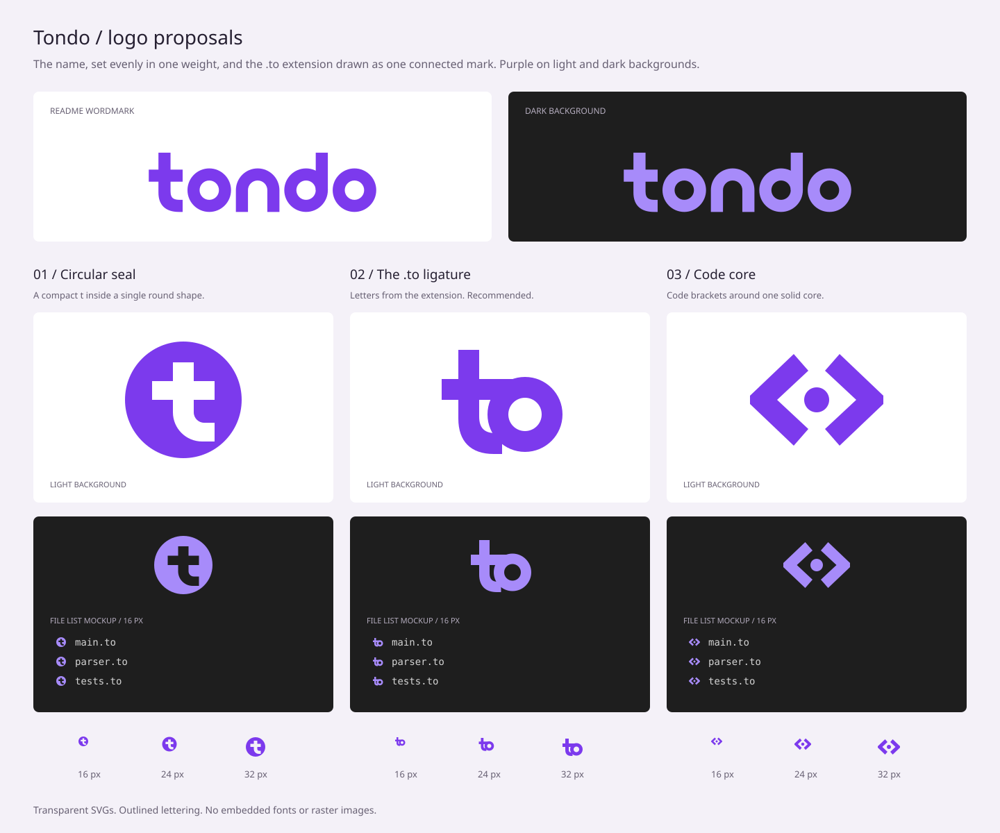

# Tondo's logo

The mark joins the `t` and `o` of `.to`, the extension of Tondo's files. Its
circular bowl and connected shape reflect “small by design, complete in
practice” and the toolchain delivered in one executable. The wordmark is the
name itself: the mark is its first two letters, and `ndo` follows in the same
weight and circles, so it reads `tondo` once.

| Asset | Use |
| --- | --- |
| [tondo.svg](tondo.svg) | Standalone mark on light backgrounds; `.to` file icon |
| [tondo-dark.svg](tondo-dark.svg) | Standalone mark on dark backgrounds |
| [tondo-wordmark.svg](tondo-wordmark.svg) | The name, for the README and documents |
| [tondo-wordmark-dark.svg](tondo-wordmark-dark.svg) | The name on dark backgrounds |
| [alternatives/round-t.svg](alternatives/round-t.svg) | Alternative: a `t` cut out of a circular seal |
| [alternatives/code-core.svg](alternatives/code-core.svg) | Alternative: code brackets around one core |

All logos have transparent backgrounds and use vector shapes, including
the lettering. They have no font, image, script or network dependencies.
The colors are `#7c3aed` for light backgrounds and `#a78bfa` for dark ones.
The standalone mark uses a 64 × 64 view box and can be rendered at 16,
24 or 32 px; the wordmark uses 199 × 66, with the mark where the standalone
one has it.

The README and the VS Code extension use the `.to` ligature; the others stay
as alternatives. The file lists in the preview are mockups for judging the
icons at 16 px, not editor screenshots.

