# std.cli

A command line read into the program's types, and what a program writes to
a terminal. A record is a command: its fields are the options and
arguments, their types say what is accepted, their documentation is the
help. An enum is subcommands. There is no builder to call and no strings to
keep in step with the code.

- [A command from a type](#a-command-from-a-type)
- [Subcommands](#subcommands)
- [Writing to a terminal](#writing-to-a-terminal)
- [What to reach for](#what-to-reach-for)

## A command from a type

```tondo
import std.cli
import std.console
import std.time

/// Copies files to a server.
type Upload = {
    /// The files to copy.
    @cli.Argument
    files: Array[String]
    /// Where to copy them.
    @cli.Option(short: "t", env: ["UPLOAD_TARGET"])
    target: String = "staging"
    /// How long to wait for the server.
    timeout: time.Duration = time.seconds(30)
    /// Says what it would do, and does nothing.
    dryRun: Bool
}

fn main() {
    for line in [["a.txt", "b.txt", "-t", "production", "--timeout", "2m"], ["--dry-run", "a.txt"], ["--port", "80"]] {
        match cli.parseArgs[Upload](line) {
            ok(upload) => console.println("{upload.files} to {upload.target}, {upload.timeout}, dry run: {upload.dryRun}")
            err(error) => console.println("{error}".lines().first() ?? "")
        }
    }
}
```

```text output
[a.txt, b.txt] to production, 2m0s, dry run: false
[a.txt] to staging, 30s, dry run: true
error: unknown option `--port`; did you mean `--target`?
```

- A field is an option, `--kebab-case` from its name, or with
  `@cli.Argument` a positional argument. `Bool` is a flag, `T?` is optional,
  `Array[T]` repeats, an enum without data is a choice, and a
  `time.Duration` is written `30s` or `1m30s`.
- A field's default is the option's, and the help shows it. `env` names
  variables of the environment to read before the default.
- [`parse`](#parse) reads the program's own arguments, prints the help for
  `-h`, and on a wrong line prints what is wrong and ends with status 2.
  [`parseArgs`](#parseargs) gives the error instead, as above.

## Subcommands

An enum is a choice of commands, each variant with its own options, and a
record can hold options that all of them share:

```tondo
import std.cli
import std.console

/// Keeps notes.
type Notes = {
    /// The directory of the notes.
    @cli.Option(short: "d")
    directory: String = "notes"
    @cli.Argument
    command: Command
}

enum Command {
    /// Adds a note.
    Add {
        @cli.Argument
        text: String
    }
    /// Lists the notes, the newest first.
    List {
        @cli.Option(short: "n", default: "10")
        limit: Int
    }
}

fn main() {
    for line in [["add", "buy tea"], ["list", "-n", "3", "-d", "work"]] {
        match cli.parseArgs[Notes](line) {
            ok(notes) => match notes.command {
                Add { text } => console.println("add `{text}` to {notes.directory}")
                List { limit } => console.println("list {limit} of {notes.directory}")
            }
            err(error) => console.println("{error}")
        }
    }
}
```

```text output
add `buy tea` to notes
list 3 of work
```

## Writing to a terminal

```tondo
import std.cli
import std.console

type Row = { service: String, requests: Int, errors: Int }

fn main() {
    let rows = [
        Row { service: "api", requests: 18204, errors: 12 },
        Row { service: "worker", requests: 932, errors: 0 },
    ]
    console.println(cli.table(rows))
    console.println(cli.table(rows, columns: ["service", "errors"]))
}
```

```text output
┌─────────┬──────────┬────────┐
│ service │ requests │ errors │
├─────────┼──────────┼────────┤
│ api     │    18204 │     12 │
│ worker  │      932 │      0 │
└─────────┴──────────┴────────┘

┌─────────┬────────┐
│ service │ errors │
├─────────┼────────┤
│ api     │     12 │
│ worker  │      0 │
└─────────┴────────┘
```

A table's columns are a record's fields, with numbers to the right.
[`markup`](#markup) styles text, and a cell of a table can have styles too.
On a terminal they are colors; in a pipe, or with `NO_COLOR`, the same
program writes the text alone:

```tondo
import std.cli
import std.console

fn main() {
    let up = cli.markup("[green]up[/]")
    let down = cli.markup("[bold red]down[/]")
    console.println(cli.markup("[bold]Services[/] [dim]at 10:42[/]"))
    console.print(
        cli.table(
            [["api", up, "18204"], ["worker", up, "932"], ["mail", down, "0"]],
            columns: ["Service", "State", "Requests"],
        ),
    )
    console.println(cli.markup("[black on yellow] note [/] [yellow]mail[/] has been down for [bold]3 min[/]"))
}
```

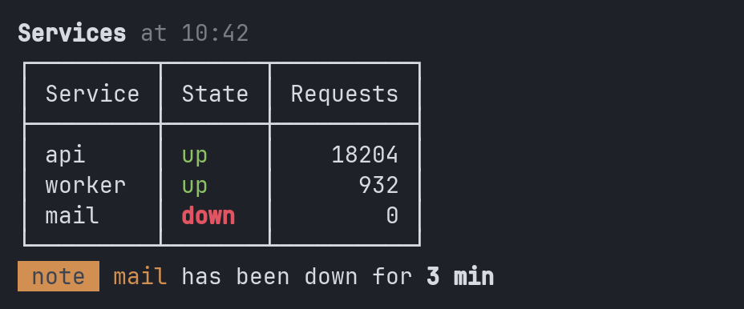

[`ask`](#ask), [`confirm`](#confirm) and [`secret`](#secret) put a question
to whoever is at the keyboard, each with what an empty answer means, and
`secret` does not show what is typed:

```tondo
import std.cli
import std.console

fn main() {
    let name = cli.ask("Project name", default: "demo")
    let port = cli.ask("Port", default: "8080")
    let token = cli.secret("Token")
    if cli.confirm("Create {name} on port {port}?") {
        console.println(cli.markup("[green]✓[/] created [bold]{name}[/], token of {token.length()} characters kept"))
    }
}
```

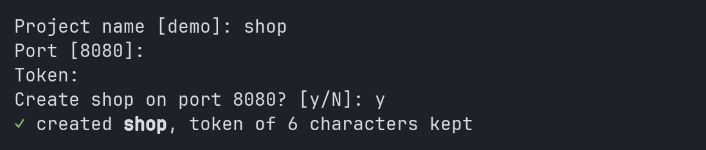

[`choose`](#choose) gives the index of one of several. On a terminal the
arrows move and Enter takes the one marked; in a pipe the answer is its
number and a line, so a script answers it too:

```tondo
import std.cli
import std.console

fn main() {
    let drinks = ["tea", "coffee", "water"]
    let chosen = cli.choose("Pick one", drinks)
    console.println("a {drinks[chosen]}")
}
```

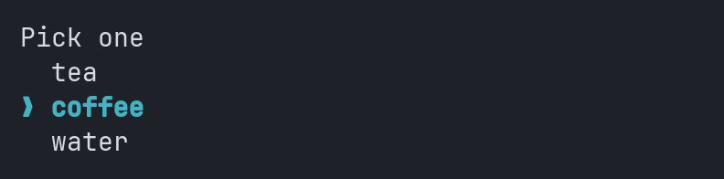

[`chooseMany`](#choosemany) gives the indices of those chosen. On a terminal
Space marks the one under the arrow and Enter ends; in a pipe the answer is
their numbers on a line, as `1,3`:

```tondo
import std.cli
import std.console

fn main() {
    let parts = ["docs", "tests", "examples"]
    let picked = cli.chooseMany("Install", parts, chosen: [0])
    console.println(picked.map((index) { parts[index] }).join(", "))
}
```

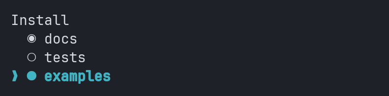

With `search: true` either one narrows its list by what is typed, the
letters in their order as `fzf` matches them, and the arrows move among
what is left. In a pipe nothing changes: the answer is a number.

```tondo
import std.cli
import std.console

fn main() {
    let countries = ["Argentina", "Chile", "Colombia", "España", "México", "Perú", "Uruguay"]
    let chosen = cli.choose("Country", countries, search: true)
    console.println(countries[chosen])
}
```

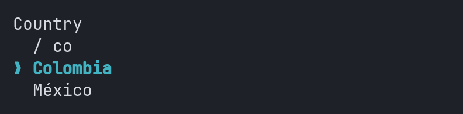

[`progress`](#progress) shows work as it advances: a bar when the total is
known, and a spinner that turns by itself when it is not. It stays at the
bottom of the output, so what the program prints meanwhile goes above it,
and two at once stack:

```tondo
import std.cli
import std.console
import std.time

fn main() {
    let copying = cli.progress("Copying", total: 8)
    let server = cli.progress("Waiting for the server")
    for step in 1..=5 {
        copying.advance()
        console.println("copied file {step}")
        time.sleep(time.milliseconds(100))
    }
    server.say("The server answered")
    time.sleep(time.seconds(1))
    server.finish()
    for _ in 6..=8 {
        copying.advance()
    }
    copying.finish()
    console.println("done")
}
```

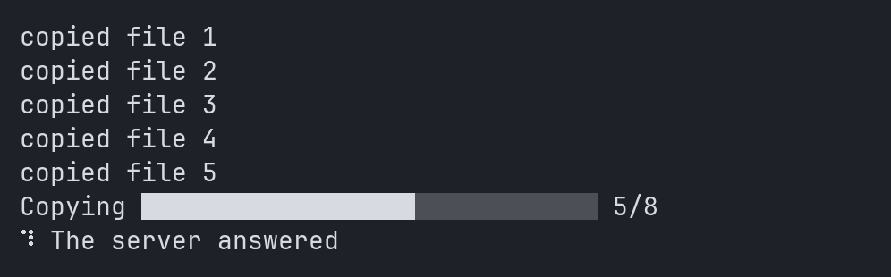

Each one that finishes leaves its last line above what comes after: the
full bar, or a mark and its label, a cross when it `failed`.

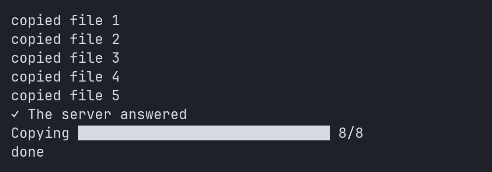

[`Live`](#live) keeps any text in that place, drawn again at each `show`: a
table, a panel, a board of several.

```tondo
import std.cli
import std.time

fn main() {
    let live = cli.Live()
    for tick in 1..=4 {
        let rows = [["api", "{tick * 120}"], ["worker", "{tick * 9}"]]
        live.show(cli.panel(cli.table(rows, columns: ["Service", "Requests"]), title: "Second {tick}"))
        time.sleep(time.milliseconds(400))
    }
}
```

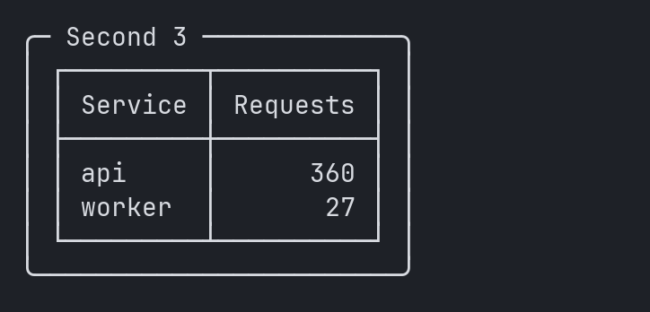

While a question is asked, what is live gives way to it, and comes back
after the answer. Off a terminal a progress writes one line when it ends,
and a `Live` its last text, once.

## Drawing with text

What draws gives a text, as `table` does, and takes a text of several lines
wherever it takes a text. So the pieces go inside each other with nothing
to learn but each one's name: a table and a panel of bars side by side,
under a rule and over a breakdown.

```tondo
import std.cli
import std.console

fn main() {
    let up = cli.markup("[green]up[/]")
    let down = cli.markup("[bold red]down[/]")
    let services = cli.table(
        [["api", up, "18204"], ["worker", up, "932"], ["mail", down, "0"]],
        columns: ["Service", "State", "Requests"],
        title: "Services",
        border: cli.Border.Rounded,
    )
    let load = cli.bars([("api", 18204.0), ("worker", 932.0), ("mail", 0.0)], width: 28)
    console.println(cli.rule("Status at 10:42", width: 70))
    console.println(cli.beside([services, cli.panel(load, title: "Requests")]))
    console.println(cli.breakdown([("used", 61.0), ("free", 39.0)], width: 70))
}
```

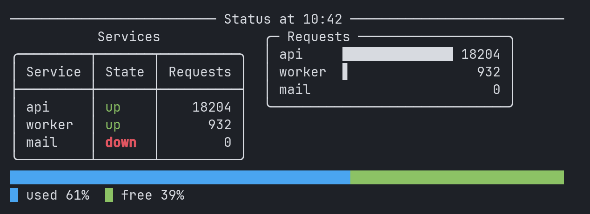

- [`panel`](#panel) puts a text in a box with a title, [`rule`](#rule)
  draws a line with one, and [`beside`](#beside) puts texts side by side,
  as many as fit the width.
- [`bars`](#bars) draws a bar for each value, by its share of the largest,
  and [`breakdown`](#breakdown) one bar of the parts of a whole.
- [`table`](#table) takes a `title:` and a [`border:`](#border), and its
  cells may have several lines.
- Widths count what shows, so a text with styles or with characters two
  columns wide lines up. Off a terminal the same program writes the same
  shapes without colors.

[`tree`](#tree) draws any value as the debugger shows it, a branch for each
field, element or entry, with what is `@secret` hidden:

```tondo
import std.cli
import std.console

type Limits = { memory: Int, cpus: Int }

type Service = {
    name: String
    hosts: Array[String]
    limits: Limits
    @secret
    token: String
}

fn main() {
    let service = Service {
        name: "web",
        hosts: ["a.example", "b.example"],
        limits: Limits { memory: 512, cpus: 2 },
        token: "s3cret",
    }
    console.println(cli.panel(cli.tree(service), title: "Service"))
}
```

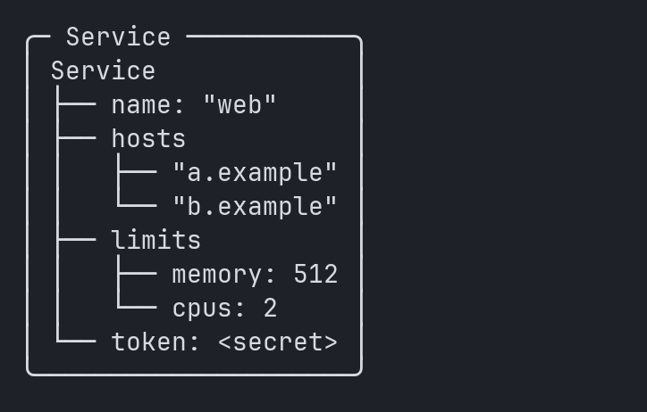

Three more give texts of their own, which go beside the rest:
[`figlet`](#figlet) writes a word in big letters, [`calendar`](#calendar) a
month with the days it is given marked, and [`json`](#json) a value as JSON
in colors, with what is `@secret` hidden.

```tondo
import std.cli
import std.console
import std.time

type Release = {
    name: String
    version: String
    targets: Array[String]
    signed: Bool
    @secret
    key: String
}

fn main() {
    let day = time.DateTime { year: 2026, month: 11, day: 14, hour: 0, minute: 0, second: 0, nanosecond: 0 }
    let release = Release {
        name: "tondo",
        version: "0.1.0",
        targets: ["linux", "macos"],
        signed: true,
        key: "s3cret",
    }
    console.println(cli.figlet("Tondo"))
    console.println(cli.beside([cli.calendar(2026, 11, marked: [day]), cli.json(release)], gap: 4))
}
```

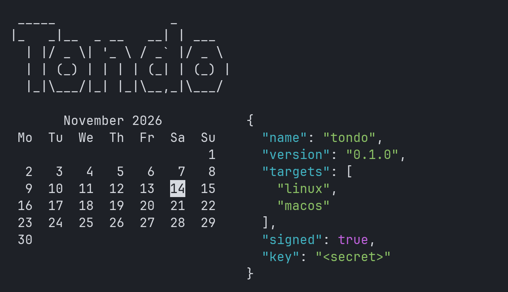

## Taking the terminal over

A program that draws its own screen, as a list to move through or a board
that changes, takes the terminal: its keys come as they are pressed, and the
screen is the program's to draw.

```tondo
import std.cli
import std.console

/// Draws the options from the top of the screen, the chosen one marked.
fn draw(options: Array[String], chosen: Int, size: cli.Size) {
    console.print("\u{1b}[2J\u{1b}[H")
    for index in 0..options.length() {
        let mark = if index == chosen { ">" } else { " " }
        console.println("{mark} {options[index]}")
    }
    console.println("─".repeat(size.columns.min(24)))
}

fn main(): !cli.TerminalError {
    let options = ["tea", "coffee", "water"]
    let terminal = cli.Terminal(screen: true)?
    let keys = terminal.keys()
    let redraws = cli.redraws()
    var chosen = 0
    var size = cli.terminalSize() ?? cli.Size { columns: 80, rows: 24 }
    draw(options, chosen, size)
    for {
        select {
            let key = keys.receive() => match key {
                some(cli.Key.Up) => chosen = (chosen - 1).max(0)
                some(cli.Key.Down) => chosen = (chosen + 1).min(options.length() - 1)
                some(cli.Key.Enter) | none => break
                _ => {}
            }
            let next = redraws.receive() => match next {
                some(now) => size = now
                // The output is no terminal: there is nothing to draw on.
                none => break
            }
        }
        draw(options, chosen, size)
    }
    terminal.release()
    console.println("a {options[chosen]}")
}
```

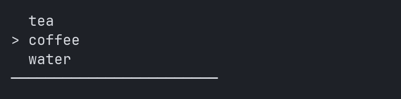

That is the screen after one Down. Down twice, Up and Enter leave
`a coffee` on the terminal, under what it showed before the program
started.

- [`cli.Terminal()`](#terminal) takes the terminal, and fails where there is
  none, as in a pipe. With `screen: true` the program draws on the alternate
  screen, as editors do, and what the terminal showed is there again when it
  is given back.
- [`keys()`](#terminalkeys) and [`redraws()`](#redraws) are channels, so one
  `select` waits for both: a [key](#key), or a size to draw again at, which
  comes when the terminal changes its size and when the program comes back
  from Ctrl-Z and `fg`. Where the output is not a terminal, as when it goes
  to a file, there are no sizes: `redraws()` is closed and gives `none`,
  which ends this program.
- The terminal is given back when its value ends, by a return, a panic or a
  cancellation, and for as long as the program is suspended. None of that
  is the program's to write.
- The questions go on working: each asks in the mode it needs and leaves
  the terminal as the program had it. On a terminal, [`choose`](#choose) is
  answered with the arrows and Enter; on a pipe, with a number and a line.
- Ctrl-C and Ctrl-Z keep their meaning. With `signals: false` they are keys,
  for a program that wants them.

A screen of several parts is made of [panes](#pane). Each is a text with
the room it takes, a fixed `size` or a `ratio` of what is left, and
`Pane.rows` and `Pane.columns` put them one above another or side by side:

```tondo
import std.cli
import std.console

fn main() {
    let orders = ["#1 tea", "#2 coffee", "#3 water"].join("\n")
    let log = (1..=40).map((n) { "request {n} answered in {n * 3 % 17 + 2} ms" }).collect().join("\n")
    let screen = cli.Pane.rows([
        cli.Pane(cli.markup("[bold]Orders today[/]"), size: 1),
        cli.Pane.columns([
            cli.Pane(orders, title: "Orders", border: cli.Border.Rounded),
            cli.Pane(log, title: "Log", ratio: 2, border: cli.Border.Rounded, follow: true),
        ]),
        cli.Pane("q: quit", size: 1),
    ])
    let size = cli.terminalSize() ?? cli.Size { columns: 64, rows: 12 }
    console.print(screen.draw(size))
}
```

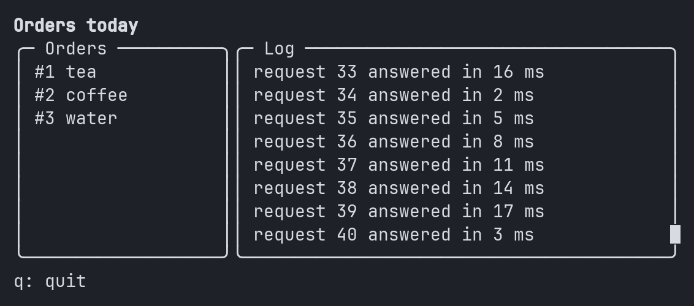

- `draw(size)` gives the screen at a size, exactly that many lines of that
  many columns, each pane's text cut to its room or padded: text as any
  other, so a test checks a screen without a terminal.
- A text longer than its pane shows its last lines with `follow: true`, as
  a log does, or from the line `from:`, which the program moves with the
  keys; the border marks where in the text the pane is. `rooms(size)`
  gives the room of each pane with a `name:`, to move by a page.
- A program with the terminal taken shows it with a [`Live`](#live) at
  each size that `redraws()` gives, and the panes take the new room.

## What to reach for

| To | Use |
| --- | --- |
| Read the command line into a type | [`parse`](#parse), [`parseArgs`](#parseargs) |
| Say how a field is written | [`Argument`](#argument), [`Option`](#option), [`Rest`](#rest) |
| Print the help, or a shell's completions | [`help`](#help), [`completions`](#completions) |
| Show rows | [`table`](#table) |
| Draw boxes, rules, trees and charts | [`panel`](#panel), [`rule`](#rule), [`beside`](#beside), [`tree`](#tree), [`bars`](#bars), [`breakdown`](#breakdown), [`Border`](#border) |
| Write big letters, a month, JSON in colors | [`figlet`](#figlet), [`calendar`](#calendar), [`json`](#json) |
| Style text | [`markup`](#markup) |
| Show progress, or keep a text drawn in place | [`progress`](#progress), [`Live`](#live) |
| Ask | [`ask`](#ask), [`confirm`](#confirm), [`choose`](#choose), [`chooseMany`](#choosemany), [`secret`](#secret) |
| Know the terminal | [`isTerminal`](#isterminal), [`terminalWidth`](#terminalwidth), [`terminalSize`](#terminalsize) |
| Take the terminal over, key by key | [`Terminal`](#terminal), [`keys`](#terminalkeys), [`Key`](#key) |
| Split the screen into parts | [`Pane`](#pane) |
| Draw again when the terminal changes | [`redraws`](#redraws) |

The [`logstat`](../../examples/logstat) and
[`warehouse`](../../examples/warehouse) examples are command lines with
subcommands.

<!-- From here on, docs/std/generate.to writes this page from `tondo api`: edit above this line. -->

## Reference

`tondo api std.cli` shows the same in a terminal.

- [Functions](#functions): [`parse`](#parse), [`parseArgs`](#parseargs), [`help`](#help), [`completions`](#completions), [`isTerminal`](#isterminal), [`terminalWidth`](#terminalwidth), [`terminalSize`](#terminalsize), [`redraws`](#redraws), [`markup`](#markup), [`table`](#table), [`panel`](#panel), [`rule`](#rule), [`beside`](#beside), [`tree`](#tree), [`bars`](#bars), [`breakdown`](#breakdown), [`calendar`](#calendar), [`json`](#json), [`progress`](#progress), [`ask`](#ask), [`confirm`](#confirm), [`choose`](#choose), [`chooseMany`](#choosemany), [`secret`](#secret), [`figlet`](#figlet)
- [Argument](#argument)
- [Option](#option)
- [Rest](#rest)
- [CliError](#clierror)
- [Shell](#shell)
- [Size](#size)
- [TerminalError](#terminalerror)
- [Terminal](#terminal): [`Terminal`](#terminal-1), [`Terminal.release`](#terminalrelease), [`Terminal.keys`](#terminalkeys)
- [Key](#key)
- [Border](#border)
- [Pane](#pane): [`Pane`](#pane-1), [`Pane.rows`](#panerows), [`Pane.columns`](#panecolumns), [`Pane.draw`](#panedraw), [`Pane.rooms`](#panerooms)
- [Progress](#progress-1): [`Progress.advance`](#progressadvance), [`Progress.say`](#progresssay), [`Progress.finish`](#progressfinish)
- [Live](#live): [`Live`](#live-1), [`Live.show`](#liveshow), [`Live.end`](#liveend)

### Functions

#### parse

```tondo
pub fn parse[T: reflect.Reflect](): T
```

The command line of the program read as a `T`: writes the help asked
for and ends with 0, or writes the error and the usage to standard error
and ends with 2.

```tondo
import std.cli
import std.console

/// Manages the notes.
enum Notes {
    /// Adds a note.
    Add(Note)
    /// Lists the notes.
    List
}

type Note = {
    /// What it says.
    text: String
}

match cli.parse[Notes]() {
    Notes.Add(note) => console.println("added {note.text}")
    Notes.List => console.println("no notes yet")
}
```

#### parseArgs

```tondo
pub fn parseArgs[T: reflect.Reflect](args: Array[String]): T ! CliError
```

The arguments, without the program's name, read as a `T`: what `parse`
does, with the failure to handle, as a test or a program that goes on
wants it. `--help` is a failure too, whose `help` is `true`.

```tondo
import std.cli
import std.console

type Options = {
    /// Who to greet.
    name: String = "world"
}

match cli.parseArgs[Options](["--name", "Ada"]) {
    ok(options) => console.println("hello {options.name}")
    err(error) => console.eprintln(error.message)
}
```

#### help

```tondo
pub fn help[T: reflect.Reflect](): String
```

The help of the command `T`.

```tondo
import std.cli
import std.console

/// Greets someone.
type Options = {
    /// Who to greet.
    name: String = "world"
}

console.print(cli.help[Options]())
```

#### completions

```tondo
pub fn completions[T: reflect.Reflect](shell: Shell): String
```

The script that completes the program's command line in `shell`, to
print for the shell to load.

```tondo
import std.cli
import std.console

type Options = {
    /// Who to greet.
    name: String = "world"
}

console.print(cli.completions[Options](cli.Shell.Bash))
```

#### isTerminal

```tondo
pub fn isTerminal(): Bool
```

Whether the console's output is a terminal: `false` when it goes to a
pipe or a file, where a question or a bar has nobody to see it.

```tondo
import std.cli
import std.console

if cli.isTerminal() {
    console.println(cli.markup("[green]ready[/]"))
} else {
    console.println("ready")
}
```

#### terminalWidth

```tondo
pub fn terminalWidth(): Int
```

The columns of the terminal of the console's output, or 80 without one.

```tondo
import std.cli
import std.console

console.println("─".repeat(cli.terminalWidth()))
```

#### terminalSize

```tondo
pub fn terminalSize(): Size?
```

The size of the terminal of the console's output, or `none` without one,
or while it reports no size, 0 by 0, as some do before one is set.

```tondo
import std.cli
import std.console

match cli.terminalSize() {
    some(size) => console.println("{size.columns}×{size.rows}")
    none => console.println("no terminal")
}
```

#### redraws

```tondo
pub fn redraws(): Receiver[Size]
```

The sizes to draw the screen at: one when the terminal changes its
size, and one when the program comes back after Ctrl-Z and `fg`, as both
mean drawing again. Two the channel has not given yet are one, the last.
A terminal that reports no size gives none until it has one. When the
output is not a terminal the channel is closed, so a `for` over it ends
at once, and in a `select` its `receive()` gives `none` at once.

```tondo
import std.cli
import std.console

fn draw(size: cli.Size) {
    console.print("\u{1b}[2J\u{1b}[H{"─".repeat(size.columns)}")
}

fn redrawing() {
    for size in cli.redraws() {
        draw(size)
    }
}

spawn detached redrawing()
```

#### markup

```tondo
pub fn markup(text: String): String
```

A text with styles, to print: `[bold red]error[/]` gives `error` in bold
red, and what follows as it was; blocks nest, and `[[` and `]]` give
brackets. With an interpolated string, its values stay as they are. No
codes off a terminal or with `NO_COLOR`.

It writes nothing itself: print what it gives.

```tondo
import std.cli
import std.console

let name = "Ada [admin]"
console.println(cli.markup("[bold red]error:[/] no user [yellow]{name}[/]"))
console.println(cli.markup("[black on #ffcc00] note [/] use [[brackets]] so"))
```

#### table

```tondo
pub fn table[T: reflect.Reflect](
    rows: Array[T],
    columns: Array[String] = [],
    title: String = "",
    border: Border = Border.Square,
): String
```

A table with a border, to print, with the numbers to the right. Its rows
are arrays, written as they are, with `columns` over them as headers and
no headers without it; a short row leaves the rest of its cells empty:

```tondo
import std.cli
import std.console

let rows = [["Ada", "36"], ["Grace", "120"]]
console.print(cli.table(rows, columns: ["Name", "Age"]))
// ┌───────┬─────┐
// │ Name  │ Age │
// ├───────┼─────┤
// │ Ada   │  36 │
// │ Grace │ 120 │
// └───────┴─────┘
```

Or records, a column a field, or those `columns` names in their order,
with the name of the field over it:

```tondo
import std.cli
import std.console

type User = { name: String, age: Int, email: String? }

let users = [User { name: "Ada", age: 36, email: none }]
console.print(cli.table(users))
console.print(cli.table(users, columns: ["age", "name"]))
```

A cell can have styles, from `markup`:

```tondo
import std.cli
import std.console

let up = cli.markup("[green]up[/]")
let down = cli.markup("[red]down[/]")
console.print(cli.table([["api", up], ["db", down]], columns: ["Service", "State"]))
```

#### panel

```tondo
pub fn panel(
    text: String,
    title: String = "",
    border: Border = Border.Rounded,
    padding: Int = 1,
    width: Int? = none,
): String
```

The text in a box, with a title on its top line. The box is as wide as
the text and its padding, or `width` columns, which clips longer lines.
It is text, so a table, a tree or other panels go inside one.

```tondo
import std.cli
import std.console

console.println(cli.panel("3 tests passed\n1 failed", title: "Results"))
// ╭─ Results ──────╮
// │ 3 tests passed │
// │ 1 failed       │
// ╰────────────────╯
```

#### rule

```tondo
pub fn rule(title: String = "", width: Int? = none): String
```

A line across the terminal, or `width` columns, with a title in its
middle.

```tondo
import std.cli
import std.console

console.println(cli.rule("Details", width: 24))
// ─────── Details ────────
```

#### beside

```tondo
pub fn beside(texts: Array[String], gap: Int = 2, width: Int? = none): String
```

Texts side by side, `gap` columns apart, as many on a row as fit the
terminal, or `width` columns, and the rest on the rows below; each is
as wide as its widest line, and its lines start together.

```tondo
import std.cli
import std.console

let left = cli.panel("api\ndb", title: "Up")
let right = cli.panel("cache", title: "Down")
console.println(cli.beside([left, right]))
```

#### tree

```tondo
pub fn tree[T: reflect.Reflect](value: T): String
```

Any value as a tree, as the debugger shows it: a record's fields, an
array's elements, a map's entries and an enum's payload are its
branches, and what has no parts ends one. What is `@secret` shows as
`<secret>`.

```tondo
import std.cli
import std.console

type Limits = { memory: Int, cpus: Int }
type Service = { name: String, hosts: Array[String], limits: Limits }

let service = Service { name: "web", hosts: ["a", "b"], limits: Limits { memory: 512, cpus: 2 } }
console.println(cli.tree(service))
// Service
// ├── name: "web"
// ├── hosts
// │   ├── "a"
// │   └── "b"
// └── limits
//     ├── memory: 512
//     └── cpus: 2
```

#### bars

```tondo
pub fn bars(values: Array[(String, Float)], width: Int? = none): String
```

A bar for each value, as long as its share of the largest, with its
label to the left and its value to the right, across the terminal or
`width` columns.

```tondo
import std.cli
import std.console

console.println(cli.bars([("tea", 12.0), ("coffee", 30.0)], width: 30))
// tea     ████████▏         12
// coffee  ████████████████████ 30
```

#### breakdown

```tondo
pub fn breakdown(parts: Array[(String, Float)], width: Int? = none): String
```

One bar across the terminal, or `width` columns, split into a part for
each value, as large as its share of the total, and under it each
part's name and share. On a terminal each part has a color; off one,
a shade of its own.

```tondo
import std.cli
import std.console

console.println(cli.breakdown([("used", 61.0), ("free", 39.0)], width: 20))
// ████████████▓▓▓▓▓▓▓▓
// █ used 61%  ▓ free 39%
```

#### calendar

```tondo
pub fn calendar(
    year: Int,
    month: Int,
    marked: Array[time.DateTime] = [],
    first: time.Weekday = time.Weekday.Monday,
    locale: String = "en",
): String
```

A month as a calendar: its name and year, the names of the days of the
week from `first`, and the days under them. On a terminal today is
underlined and the days of `marked` in reverse; off one, the days of
`marked` are in brackets, so what a script writes still shows them. The
names are those of `locale`.

```tondo
import std.cli
import std.console
import std.time

let release = time.DateTime { year: 2026, month: 11, day: 14, hour: 0, minute: 0, second: 0, nanosecond: 0 }
console.println(cli.calendar(2026, 11, marked: [release]))
//        November 2026
//  Mo  Tu  We  Th  Fr  Sa  Su
//                           1
//   2   3   4   5   6   7   8
//   9  10  11  12  13 [14] 15
// ...
```

#### json

```tondo
pub fn json[T: reflect.Reflect + serialization.Encode](value: T, indent: Int = 2): String
```

A value as JSON, as `json.encode` writes it, with each level `indent`
spaces in, or on one line with `indent: 0`; on a terminal its keys,
texts, numbers and `true`, `false` and `null` have colors of their own.
What is `@secret` is `"<secret>"`, as dumps show it.

```tondo
import std.cli
import std.console

type Service = { name: String, port: Int, hosts: Array[String] }

console.println(cli.json(Service { name: "web", port: 8080, hosts: ["a", "b"] }))
// {
//   "name": "web",
//   "port": 8080,
//   "hosts": [
//     "a",
//     "b"
//   ]
// }
```

#### progress

```tondo
pub fn progress(label: String, total: Int? = none): Progress
```

A progress of the work `label` of `total` steps, drawn now.

```tondo
import std.cli

let bar = cli.progress("Building", total: 3)
bar.advance()
bar.advance(by: 2)
bar.finish()

let work = cli.progress("Connecting")
work.say("Downloading")
work.finish()
```

#### ask

```tondo
pub fn ask(question: String, default: String = ""): String
```

The answer to a question, or `default` when it is left empty or the input
has ended.

```tondo
import std.cli
import std.console

let name = cli.ask("Name")
let city = cli.ask("City", default: "Lima")
console.println("{name} from {city}")
```

#### confirm

```tondo
pub fn confirm(question: String, default: Bool = false): Bool
```

`true` for `y` or `yes`, `false` for `n` or `no`, `default` when it is
left empty or the input has ended; anything else asks again.

```tondo
import std.cli
import std.console

if not cli.confirm("Start the server?") {
    console.println(cli.markup("[red]Server not started.[/]"))
    return
}
```

#### choose

```tondo
pub fn choose(question: String, options: Array[String], search: Bool = false): Int
```

The index in `options` of the one chosen. On a terminal the arrows move
a mark over them and Enter chooses; elsewhere, as from a pipe, it is
chosen by its number, from 1 as they are shown, anything else asks
again, and the first is taken when the input has ended.

```tondo
import std.cli
import std.console

let drinks = ["tea", "coffee"]
let chosen = cli.choose("Pick one", drinks)
console.println("a {drinks[chosen]}")
```

#### chooseMany

```tondo
pub fn chooseMany(
    question: String,
    options: Array[String],
    chosen: Array[Int] = [],
    search: Bool = false,
): Array[Int]
```

The indices in `options` of those chosen, in order. On a terminal the
arrows move a mark over them, Space marks one or takes its mark away,
and Enter ends, with those of `chosen` marked at first; elsewhere, as
from a pipe, they are chosen by their numbers on one line, from 1 as
they are shown, `1,3` or `1 3`: an empty line, or the input's end,
keeps `chosen`, and anything else asks again.

```tondo
import std.cli
import std.console

let parts = ["docs", "tests", "examples"]
let picked = cli.chooseMany("Install", parts, chosen: [0])
console.println(picked.map((index) { parts[index] }).join(", "))
```

#### secret

```tondo
pub fn secret(question: String): String
```

An answer read without showing it, when the input is a terminal.

```tondo
import std.cli

let password = cli.secret("Password")
_ = password
```

#### figlet

```tondo
pub fn figlet(text: String, font: String? = none, width: Int? = none): String
```

The text in big letters, as FIGlet writes them: in its standard font,
or in `font`, the text of a `.flf` file, as `std.embed` gives one. Wider
than the terminal, or `width` columns, it goes on below, between words.

```tondo
import std.cli
import std.console

console.println(cli.figlet("Tondo"))
//  _____               _
// |_   _|__  _ __   __| | ___
//   | |/ _ \| '_ \ / _` |/ _ \
//   | | (_) | | | | (_| | (_) |
//   |_|\___/|_| |_|\__,_|\___/
```

### Argument

```tondo
pub annotation Argument = {
    /// The value when it is missing, written as on the command line.
    default: String? = none
}
```

Makes a field a positional argument, in the order of the fields.

Implements `reflect.Reflect`.

### Option

```tondo
pub annotation Option = {
    short: String? = none
    default: String? = none
    env: Array[String] = []
    hidden: Bool = false
}
```

How a field is written as an option: its letter, its value when it is
missing, written as on the command line, the variables of the
environment read before it, the first that is set, and whether the help
leaves it out.

Implements `reflect.Reflect`.

### Rest

```tondo
pub annotation Rest = {
    /// What the help calls them.
    name: String = "args"
}
```

Makes a field, an `Array[String]`, take what the command does not read:
the arguments after `--`, the options it does not declare and the
arguments past its own, as written, to pass them on to another program.

Implements `reflect.Reflect`.

### CliError

```tondo
pub type CliError = {
    message: String
    help: Bool
}
```

Why a command line was not read, with the usage of its command, or the
help that it asked for.

```tondo
import std.cli
import std.console

type Options = { count: Int = 1 }

match cli.parseArgs[Options](["--count", "many"]) {
    ok(options) => console.println("{options.count}")
    err(error) => console.println("{error.message}")
}
```

Implements `Display`, `reflect.Reflect`.

### Shell

```tondo
pub enum Shell {
    Bash
    Zsh
    Fish
}
```

A shell whose completion `completions` writes.

```tondo
import std.cli
import std.console

type Options = { verbose: Bool = false }

// What `myapp completions zsh` prints, for the shell to load.
console.print(cli.completions[Options](cli.Shell.Zsh))
```

### Size

```tondo
pub type Size = {
    columns: Int
    rows: Int
}
```

The size of a terminal, in characters.

```tondo
import std.cli
import std.console

let size = cli.terminalSize() ?? cli.Size { columns: 80, rows: 24 }
console.println("{size.columns} columns, {size.rows} rows")
```

### TerminalError

```tondo
pub enum TerminalError {
    /// The program's input is not a terminal, but a pipe or a file.
    NotATerminal
    /// Another `cli.Terminal` holds it.
    Taken
}
```

Why `cli.Terminal()` could not take the terminal.

```tondo
import std.cli
import std.console

match cli.Terminal() {
    ok(terminal) => terminal.release()
    err(cli.TerminalError.NotATerminal) => console.println("no terminal to take")
    err(cli.TerminalError.Taken) => console.println("taken already")
}
```

Implements `Display`, `reflect.Reflect`.

### Terminal

```tondo
pub type Terminal = {
    // private fields
}
```

The terminal, taken over by the program. Keys arrive as they are pressed
rather than in lines, unless `lines`, and are not shown, unless `echo`;
`screen` draws on the alternate screen, as editors do, and the terminal
shows what it had when it is given back; with `signals: false` Ctrl-C
and Ctrl-Z are keys rather than cancelling and suspending the program.

It is given back as it was when its value ends, also through a panic or
a cancellation, and while the program is suspended by Ctrl-Z, until `fg`
takes it again and `redraws()` gives the size to draw at. `release`
gives it back before. The questions of this module ask in the mode each
needs while it is held, and then leave it as it was.

```tondo
import std.cli
import std.console

fn main(): !cli.TerminalError {
    let terminal = cli.Terminal()?
    console.println("press q to end")
    for key in terminal.keys() {
        if key == cli.Key.Char('q') {
            break
        }
    }
}
```

#### Terminal

```tondo
pub fn Terminal(
    echo: Bool = false,
    lines: Bool = false,
    screen: Bool = false,
    signals: Bool = true,
): Terminal ! TerminalError
```

The terminal, taken in the mode asked: fails without one, or while
another `cli.Terminal` holds it.

#### Terminal.release

```tondo
pub fn Terminal.release(self)
```

Gives the terminal back now, as it was; its keys end.

#### Terminal.keys

```tondo
pub fn Terminal.keys(self): Receiver[Key]
```

The keys pressed from now on: arrows, Enter and the rest as their own
variants, a key with Ctrl or Alt as one with that letter, and a lone
Escape told from the start of a sequence by the pause after it. While a
question of this module asks, the keys are its own. The channel closes
when the terminal is given back.

### Key

```tondo
pub enum Key {
    /// A character, as it was typed.
    Char(Char)
    /// Ctrl with a letter, in lowercase, or with a space or a sign.
    Ctrl(Char)
    /// Alt with a character.
    Alt(Char)
    Enter
    Tab
    /// Shift and Tab.
    BackTab
    Backspace
    Delete
    Insert
    Escape
    Up
    Down
    Left
    Right
    Home
    End
    PageUp
    PageDown
    /// A function key, from F1.
    F(Int)
}
```

A key pressed on a taken terminal.

```tondo
import std.cli

fn moved(key: cli.Key, at: Int): Int {
    match key {
        cli.Key.Up | cli.Key.Char('k') => at - 1
        cli.Key.Down | cli.Key.Char('j') => at + 1
        _ => at
    }
}

assert(moved(cli.Key.Down, 3) == 4)
```

### Border

```tondo
pub enum Border {
    Square
    Rounded
    Double
    Heavy
    Ascii
    None
}
```

How a box or a table is drawn. A table with `None` is a grid, its
columns aligned and nothing between them but spaces.

```tondo
import std.cli
import std.console

console.println(cli.panel("ready", border: cli.Border.Double))
console.print(cli.table([["a", "1"], ["b", "2"]], border: cli.Border.None))
```

### Pane

```tondo
pub type Pane = {
    // private fields
}
```

A part of a screen: a text, with a title and a border if asked, that
takes a fixed `size` of rows or columns, or a `ratio` of what the fixed
ones leave. `Pane.rows` stacks panes top to bottom and `Pane.columns`
left to right, and they nest. A text longer than its pane shows from
line `from`, or its last lines with `follow`, as `tail -f` does, and a
border marks where in the text the pane is. `draw` gives the screen at
a size, exactly as many lines as its rows, each as wide as its columns.

```tondo
import std.cli
import std.console

let screen = cli.Pane.rows([
    cli.Pane("Orders today", size: 1),
    cli.Pane.columns([
        cli.Pane("#1 tea\n#2 coffee", title: "Orders", border: cli.Border.Rounded),
        cli.Pane("#2: 2 cups", title: "Detail", ratio: 2, border: cli.Border.Rounded),
    ]),
    cli.Pane("q: quit", size: 1),
])
console.println(screen.draw(cli.Size { columns: 40, rows: 8 }))
```

#### Pane

```tondo
pub fn Pane(
    text: String = "",
    title: String = "",
    size: Int? = none,
    ratio: Int = 1,
    border: Border = Border.None,
    follow: Bool = false,
    from: Int = 0,
    name: String = "",
): Pane
```

A pane of `text`. `name` gives its room in `rooms`, to page by its
height.

#### Pane.rows

```tondo
pub fn Pane.rows(parts: Array[Pane]): Pane
```

The panes one above another, as tall as the room each takes.

#### Pane.columns

```tondo
pub fn Pane.columns(parts: Array[Pane]): Pane
```

The panes side by side, as wide as the room each takes.

#### Pane.draw

```tondo
pub fn Pane.draw(self, size: Size): String
```

The screen at `size`: `size.rows` lines of `size.columns` columns, each
pane's text cut to its room, or padded, so nothing is torn.

#### Pane.rooms

```tondo
pub fn Pane.rooms(self, size: Size): Map[String, Size]
```

The room of each pane with a `name`, inside its border: the rows and
columns its text has at `size`.

```tondo
import std.cli
import std.console

let screen = cli.Pane.rows([cli.Pane("head", size: 1), cli.Pane("…", name: "log", border: cli.Border.Square)])
let rooms = screen.rooms(cli.Size { columns: 40, rows: 10 })
console.println("{rooms["log"]}")
```

### Progress

```tondo
pub type Progress = {
    // private fields
}
```

A bar of the progress of some work, or a spinner when it has no total,
in the live region at the bottom of a terminal: what the program prints
goes above it, two at once stack, and a spinner turns by itself. Off a
terminal it writes one line when it finishes.

```tondo
import std.cli

let files = ["a.txt", "b.txt", "c.txt"]
let bar = cli.progress("copying", total: some(files.length()))
for _ in files {
    bar.advance()
}
bar.finish()
```

#### Progress.advance

```tondo
pub fn Progress.advance(self, by: Int = 1)
```

Counts `by` more steps done.

#### Progress.say

```tondo
pub fn Progress.say(self, label: String)
```

Says what the work does now, in place of its label.

#### Progress.finish

```tondo
pub fn Progress.finish(self, failed: Bool = false)
```

Ends the progress, its last line left above what comes after: a full
bar, or `✓` and the label, and `✗` when it `failed`. Off a terminal, its
one line.

### Live

```tondo
pub type Live = {
    // private fields
}
```

Text at the bottom of a terminal, drawn again in place each time it is
shown: what the program prints goes above it, and two at once, or one
and a progress, stack. Off a terminal it writes nothing until it ends,
then its last text once. It ends with its value, through a panic or a
cancellation too, or at `end`, its last text left written above what
comes after.

```tondo
import std.cli
import std.time

let live = cli.Live()
for second in 0..3 {
    live.show(cli.panel("{3 - second} s left", title: "Launch"))
    time.sleep(time.milliseconds(10))
}
live.end()
```

#### Live

```tondo
pub fn Live(): Live
```

A live region of its own, empty until shown.

#### Live.show

```tondo
pub fn Live.show(self, text: String)
```

Shows `text` in place of what it showed.

#### Live.end

```tondo
pub fn Live.end(self)
```

Ends it now, its last text left written.
